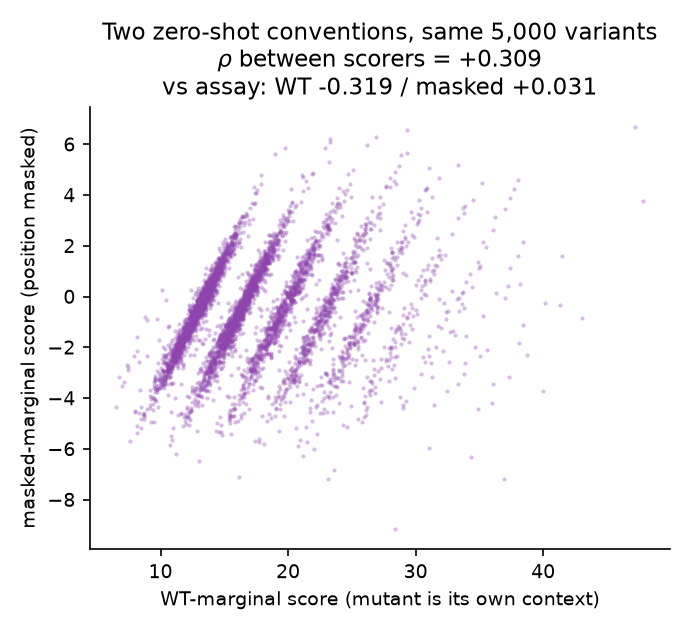
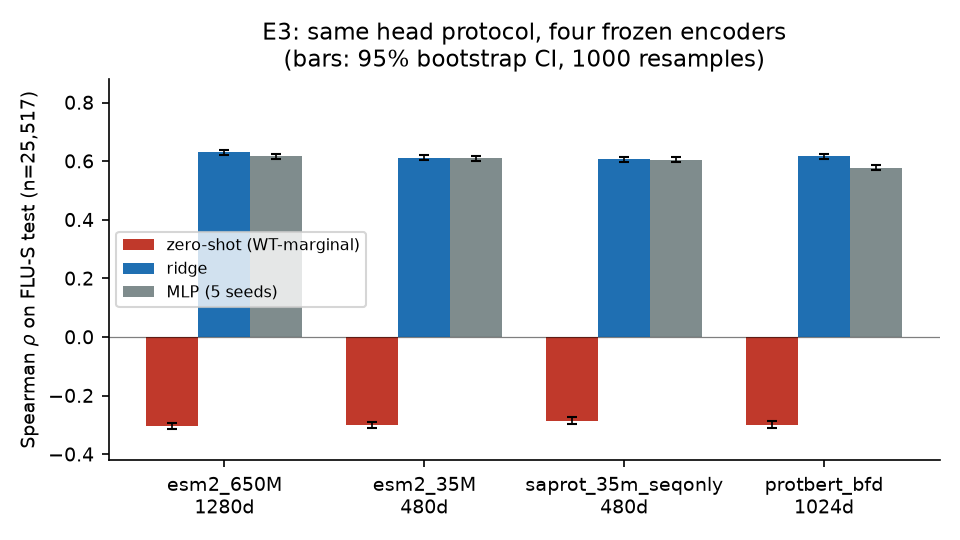
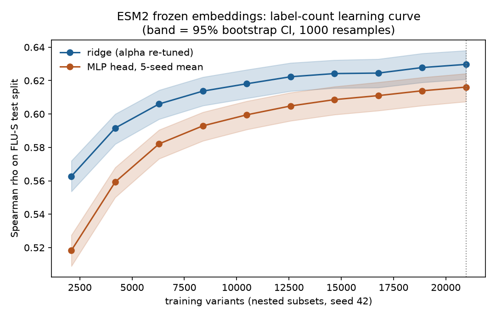

# esm2-flu-s

ESM2 在 TAPE 荧光蛋白（FLU-S）上的**零样本打分 vs 轻量微调**复现，含数据登记、
多 seed、bootstrap 置信区间、成本记录、四模型同协议横评、标注量学习曲线与负结果。

> 目的不是刷分，而是给「结构/功能预测模型复现」这件事留下可点验的证据：
> 每个数字都能回到某个脚本、某个文件。

## 数据

- 来源：TAPE `fluorescence`（`s3://songlabdata/proteindata/data_raw_pytorch/fluorescence.tar.gz`）
- 官方切分：train 21,446 / valid 5,362 / test 27,217
- 长度不齐（235/236/237），**只保留 237**（众数长度），丢弃 71 + 2,239 条，丢弃数记在
  `data/processed/manifest.json` 的 `dropped_length_counts`
- 保留后：train 20,963 / valid 5,235 / test 25,517
- 野生型：由全部序列逐位取众数得到共识 WT（237 aa），**用 TAPE 自带的 `num_mutations`
  字段做校验：51,715 条全部复现，100% 一致**（`manifest.json` 的 `splits.*.num_mutations_match`）
- 切分性质：train 平均 2.43 个突变（最多 3），test 平均 5.37（最多 15）——test 是外推切分

## 方法

| 臂 | 做法 |
|---|---|
| `null_mean` | 全部预测训练集均值（无排序能力） |
| `null_nmut` | 只按突变数排序（`-num_mutations`），不看序列 |
| `zero_shot` | ESM2-650M WT-marginal：`Σ[log p(mt|mut) − log p(wt|mut)]`，不训练 |
| `zero_shot_masked` | masked-marginal：逐突变位点 mask 后同式计算（去掉自洽偏差），5,000 条子样本 |
| `ridge` | 冻结 ESM2 平均池化嵌入（1280 维）+ 岭回归，alpha 在 valid 上选 |
| `mlp` | 同上嵌入 + 2 层 MLP（256 隐层），5 个 seed |

横评（E3）把同一套头协议（同 alpha 网格、同 5 seeds、同 CI 口径）搬到四个冻结编码器上：
ESM2-650M / ESM2-35M / SaProt-35M-seqOnly / ProtBERT-BFD，见 `results/model_comparison.md`。

成本：单张 RTX 2080 Ti 11 GB。ESM2-650M 嵌入提取 27.6 / 27.3 / 27.0 seq/s（test / valid / train），
峰值显存 4,146 MiB；其余模型 195–946 s 全量（`results/embed/<model>/timing_embed.json`）。

## 结果（test，n=25,517）

见 `results/report.md`（由脚本生成，不手写）。图由 `src/make_figures.py` 生成，
图上每个数字都从 `results/metrics.json` 断言对齐，不会与表格漂移。
所有置信区间为 bootstrap 95% 百分位区间（1000 次重采样，rng seed 0），主表、子样本表与分层表同一口径。

| | |
|---|---|
|  |  |
| 岭回归在 test 上的预测 vs 实测（Spearman +0.630，bootstrap CI） | 按突变数分层：外推一崩全崩，虚线为「只看突变数」基线；误差棒为 bootstrap 95% CI |
|  |  |
| 同一批 5,000 条，WT-marginal vs masked-marginal：两种口径之间 ρ 仅 +0.309 | 四个冻结编码器的三臂对比，误差棒为 bootstrap 95% CI |

主结论：

- 岭回归 **+0.630**（alpha=0.001，在 valid 上从 1e−4 到 1e4 共 14 点选出，非边界解），
  MLP 五 seed +0.611 / +0.611 / +0.605 / +0.612 / +0.606，五 seed 平均 **+0.617**
  （seed 0–2 的 Spearman 与旧三 seed 运行一致到 4 位小数，新增 seed 3/4 未改变结论）
- 零样本（WT-marginal）**−0.304**，比「只看突变数」的 +0.342 还差；换成 masked-marginal
  后变成 **+0.031**（两种口径的分数之间相关只有 +0.309）
- 按突变数分层（bootstrap 95% CI）：岭回归在 4–6 个突变上 +0.693 [+0.685, +0.700]，
  7–10 掉到 +0.136 [+0.107, +0.164]，11–15 只剩 +0.018 [−0.130, +0.151]——CI 跨 0，
  与「无排序能力」无法区分

**这说明什么、不说明什么**：说明冻结表征 + 轻量头在这份基准上能学到排序信号，
而零样本打分在这份数据上不成立；不说明 ESM2 对荧光蛋白一般无效，也不说明
「线性头比非线性头好」——0.630 与 0.617 的 CI 大面积重叠，只能说线性头已吃到大部分信号。

## 横评（E3）：同一头协议 × 四个冻结编码器

完整表与判读见 `results/model_comparison.md`（由 `src/compare_models.py` 生成，
连跑两次产物 sha256 一致；esm2_650M 行与主表 `metrics.json` 四条断言对齐）。要点：

- ridge：650M +0.630 > ProtBERT +0.617 > 35M +0.612 > SaProt-seqOnly +0.607——
  点估计排序如此，但 CI 只区分出「650M 优于 35M 与 SaProt-seqOnly」；
  650M vs ProtBERT、35M vs SaProt、ProtBERT vs 两个小模型均重叠，名次不可区分。
- 零样本 WT-marginal 在**全部四个模型**上都是 −0.29 ~ −0.30 且 CI 完全在 0 以下：
  负排序不是 650M 的偶发，而是该打分口径在这个任务上的系统性反转。
- SaProt 用作者发布的 seqOnly 变体（无结构 token 输入时的合法对比口径）；
  ProtBERT 的 input_ids 按其发布 vocab.txt 行号手工构造（原因见 `src/embed.py` `ManualBertTok` 注释）。
- 这是「单蛋白、单任务、同一协议下的编码器快照」，不构成对模型通用强弱的一般结论。

## 分层收窄的显著性检验（E4）

上面的分层表此前只到「CI 肉眼看分开」；E4 把 Δρ 本身当检验对象（表在
`results/report.md`，数值在 `results/metrics.json` 的 `strata_tests`）：

- 层间（不同层是互不相交的变体 ⇒ 独立相关）：Δρ 用 bootstrap 百分位 CI
  （1000 次、seed 0、每层独立抽样流）作主推断，Fisher r-to-z 作交叉核对，
  9 个比较做 Bonferroni；层内（同批变体 ⇒ 相关不独立）：配对 bootstrap
  （同一重抽样索引），即 Steiger 型检验的非参数对应。
- **岭回归 4–6 → 7–10：Δρ=+0.557 [+0.528, +0.585]，校正后 p<1e−300；MLP 同理
  （+0.533）**——「适用域随突变数收窄」从此是检验结论，不只是 CI 观感。
- 但 7–10 vs 11–15 不可区分：ridge p=0.11；mlp 的 CI 下限 +0.005 名义不含 0，
  Bonferroni 后 p=0.39，按边缘处理不作结论。数据支持的是「4–6 显著高于两个
  更高层」，**不支持逐级单调下降**。
- 零样本的层间差方向相反：ρ 从 −0.21 升到 −0.05（4–6 vs 7–10 显著，p≈1e−25）
  ——负相关强度随外推衰减，而不是恒定坏。
- 层内对照：4–6 层 ridge−mlp 差 +0.020 统计可区分但效应极小，「线性头已吃到
  大部分信号」不受影响；11–15 层三个模型两两不可区分，且都与 0 无法区分。
- 可检上限必须一起报：11–15 层 n=191，与首层比较的最小可检差（Fisher-z 尺度、
  80% 功效）≈0.21——该层「检不出」不等于「无差异」。
- 可复现性：`analyze.py` 连跑两轮，`strata_tests` 及其余分析字段逐字节一致，
  唯一波动是 `mlp_ensemble.train_seconds`（墙钟遥测，非分析数字）。

## 标注量学习曲线（E5）

问题：headline（ridge +0.630 / MLP +0.617）是不是被 train split 的标注量卡住？
曲线由 `src/learning_curve.py` 生成，头协议与 `analyze.py` 完全对齐（同 alpha 网格、
同 5 seeds、同 CI 口径）；子集是 rng seed 42 单次置换的 10 档**嵌套**分数（10%–100%）。
控制内置：100% 档必须复现 `metrics.json`，否则脚本拒绝写产物。实测 ridge 精确相等
（确定性 alpha 选择 + 同种子）；MLP 五 seed 均值 +0.6161 vs 报告 +0.6166，差 0.0005。
MLP 那条容差不再是手写的 0.01，而是由本次实测的 seed 离散度推出：
`min(0.01, max(2 × seed sd, 0.002))`，实测 = 2 × 0.0033 = **0.0066**（100% 档 5 seed
极差 0.0075，与本文前面报的 0.007 同量级）。这个数是关键而不是装饰：headline 的
ridge−MLP 差只有 0.0136，若门禁仍写死 0.01，「通过控制」与「结论本身」几乎同宽，
通过与否不再承载信息；派生后容差是 headline 差值的 **0.49 倍**（`control.tolerance_vs_headline_gap`），
控制行与结论行才各自有意义。控制失败时脚本直接 `SystemExit`，不写任何产物。



- ridge：10%（2,096 条）**+0.563 [+0.554, +0.572]** → 50% **+0.618 [+0.609, +0.627]** →
  100% **+0.630 [+0.621, +0.638]**。一半数据已恢复全量 Spearman 的 98%；60% 之后
  每步增益 ≤0.008，与该档 CI 宽度（约 0.018）同量级，不能称为可区分的增长。
- MLP（5 seed 平均）：10% **+0.518 [+0.509, +0.528]** → 100% **+0.616**。全程低于
  ridge，且差距随数据缩小而拉大（10% 档差 0.044，50% 差 0.019，100% 差 0.014）——
  非线性头的相对劣势集中在小标注端；「线性头已吃到大部分信号」由此多了一维支撑，
  不再只是「两个 CI 大面积重叠」。
- alpha 每档在 valid 上重选：10 档里 9 档选到 0.001（仅 20% 档选 0.0003），
  正则强度在该数据量区间基本不敏感。
- **这说明什么、不说明什么**：说明在这份基准上，头性能到约一半数据后已进入平台，
  headline 不是数据饥渴的结果；不说明「不需要那么多数据」——曲线基于单次置换的
  嵌套子集，换一次抽样平台位置可能移动一档左右，这是量级事实，不是数据量设计建议。

## 外部对照（已发表数字，核过原文）

完整对照与逐条口径差异见 [`docs/external_baselines.md`](docs/external_baselines.md)
（2026-11-18 逐条抓取原文核对）。要点：

- **同任务发表最佳**：TAPE 论文 Table 2 荧光列 test Spearman——预训练 Transformer（38M，端到端微调）**0.68**、
  无预训练 0.22、one-hot 0.14。本仓库冻结 650M 嵌入 + 岭回归 **+0.630** 是同任务、不同协议、
  长度过滤子集上的量级参照，不能写成"复现/超过 TAPE 最佳"。
- **"ESM-1v/ESM2 论文的 FLU 数字"不存在**：ESM-1v 用 41 个 DMS（其 FLU 前缀是流感蛋白，非 GFP 任务），
  ESM2 论文正文无荧光表——两篇的专项数字本仓库一律不引用，引用其跨任务均值时必须注明非同任务。
- **打分口径有文献先例**：ESM-1v 附录（Table 5）已证 masked marginals 优于 wildtype marginals；
  本仓库把这一方向推到单一荧光任务上的"负排序 vs +0.031"，口径差异见文档 §6。
- ProteinGym Table 2 的 ESM2-15B 0.401 等是**跨 217 assay 均值**，不与单任务数字并表；其表中无 SaProt。

## 环境

- Python 3.13；依赖见 `requirements.txt`（torch 需从 cu124 官方索引安装）
- 单张 RTX 2080 Ti 11 GB；模型权重在 `models/`，不随仓库分发：
  ESM2-650M / 35M（facebook 官方 checkpoint）、SaProt_35M_AF2_seqOnly（westlake-repl）、
  prot_bert_bfd（Rostlab）。本机直连 huggingface.co DNS 失败，权重经 `src/fetch_weights.py`
  从 hf-mirror.com 拉取（必须带浏览器 User-Agent，否则 403），逐文件 sha256 记在
  `models/manifest_e3.json`
- ProtBERT 无 tokenizer.json，且 transformers 5 的 BertTokenizer 会把大写残基小写化、
  把 special token 登记到与 checkpoint 冲突的位置——输入 id 由 `ManualBertTok` 按发布
  `vocab.txt` 行号手工构造（每残基一 token，[CLS]=2 / [SEP]=3 与 checkpoint 一致）
- `data/`（TAPE 原始包与清洗产物）与 `results/embed/`（四个模型的嵌入打分缓存）不进 git：
  数据按上文链接下载，缓存由 `src/prepare.py` 与 `src/embed.py` 再生成

## 复现

```bash
python src/prepare.py                       # 数据登记 + 共识 WT + 校验
python src/fetch_weights.py                 # E3 新权重（hf-mirror，带浏览器 UA；已存在则只补哈希）
python src/embed.py --splits test,valid,train  # 嵌入 + WT-marginal 打分（ESM2-650M）
python src/embed.py --model esm2_35M        # 横评其余三模型，同理
python src/embed.py --model saprot_35m_seqonly
python src/embed.py --model protbert_bfd
python src/zeroshot_masked.py --split test --variants 5000 --batch 32
python src/analyze.py                       # 指标、bootstrap CI、分层、分层差检验（E4）、报告
python src/compare_models.py                # E3 横评表（650M 行与 metrics.json 断言对齐）
python src/learning_curve.py                # E5 标注量学习曲线（100% 档断言对齐 metrics.json，失败拒写）
python src/make_figures.py                  # README 四张图（断言与 metrics.json / model_comparison.json 对齐）
```

## 红线（不能写成什么）

- 不能写「RFdiffusion / AlphaFold / ESM 熟练」——本项目只做了 ESM2 / SaProt-seqOnly / ProtBERT 的冻结表征与打分
- 不能写「复现了 ESM2 论文结果」——只在这一个基准上、只用自己的切分与打分口径
- 不能写湿实验、不能写「证明了突变效应机制」
- WT-marginal 与 masked-marginal 的差别必须写出来，不能只报好看的那个
- 横评是单蛋白单任务快照，不能写成「跨基准的模型通用强弱排名」；CI 重叠的名次不能写成「A 优于 B」
- 分层差只能按 `strata_tests` 的双口径措辞引用：「单调下降」不能写（7–10 vs 11–15 不可区分，
  mlp 属边缘）；4–6 层 ridge−mlp 的 +0.020「可区分」不能写成「ridge 优于 mlp」的能力结论；
  11–15 层的任何「无差异」必须同时报可检上限（MDE≈0.21）

## 引用（How to cite）

本仓库以 GitHub Release v1.0 作为固定引用版本；机器可读元数据见根目录 `CITATION.cff`（GitHub 会自动在侧栏展示引用建议）。若后续分配了 DOI，请优先引用 DOI。

```bibtex
@software{wu2026esm2flus,
  author  = {{吴奕婷 (Yiting Wu)}},
  title   = {esm2-flu-s：ESM2 在 TAPE 荧光蛋白（FLU-S）上的零样本打分 vs 轻量微调可复现基准},
  url     = {https://github.com/fakenice/esm2-flu-s},
  version = {1.0},
  date    = {2026-11-18}
}
```
