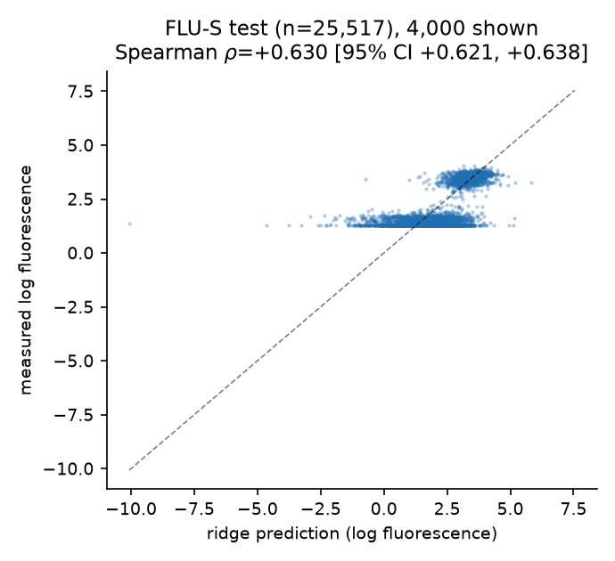
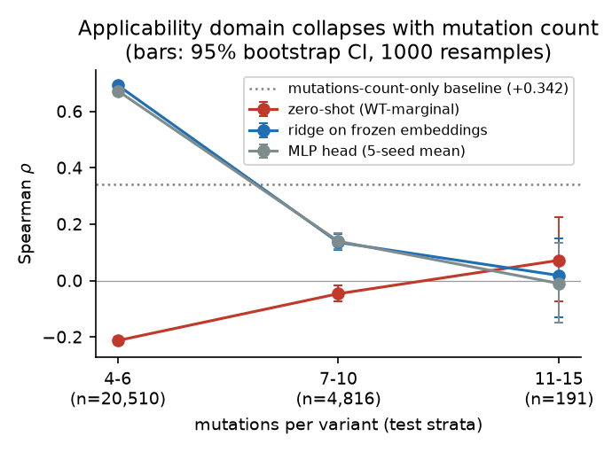

# esm2-flu-s

ESM2 在 TAPE 荧光蛋白（FLU-S）上的**零样本打分 vs 轻量微调**复现，含数据登记、
多 seed、bootstrap 置信区间、成本记录与负结果。

> 目的不是刷分，而是给「结构/功能预测模型复现」这件事留下可点验的证据：
> 每个数字都能回到某个脚本、某个文件。

## 数据

- 来源：TAPE `fluorescence`（`s3://songlabdata/proteindata/data_raw_pytorch/fluorescence.tar.gz`）
- 官方切分：train 21,446 / valid 5,362 / test 27,217
- 长度不齐（235/236/237），**只保留 237**（众数长度），丢弃 71 + 2,239 条，丢弃数记在
  `data/processed/manifest.json` 的 `dropped_length_counts`
- 保留后：train 20,963 / valid 5,235 / test 25,517
- 野生型：由全部序列逐位取众数得到共识 WT（237 aa），**用 TAPE 自带的 `num_mutations`
  字段做校验：51,715 条全部复现，100% 一致**（`manifest.json` 的 `splits.*.num_mutations_match`）
- 切分性质：train 平均 2.43 个突变（最多 3），test 平均 5.37（最多 15）——test 是外推切分

## 方法

| 臂 | 做法 |
|---|---|
| `null_mean` | 全部预测训练集均值（无排序能力） |
| `null_nmut` | 只按突变数排序（`-num_mutations`），不看序列 |
| `zero_shot` | ESM2-650M WT-marginal：`Σ[log p(mt|mut) − log p(wt|mut)]`，不训练 |
| `zero_shot_masked` | masked-marginal：逐突变位点 mask 后同式计算（去掉自洽偏差），5,000 条子样本 |
| `ridge` | 冻结 ESM2 平均池化嵌入（1280 维）+ 岭回归，alpha 在 valid 上选 |
| `mlp` | 同上嵌入 + 2 层 MLP（256 隐层），5 个 seed |

成本：单张 RTX 2080 Ti 11 GB。嵌入提取 27.6 / 27.3 / 27.0 seq/s（test / valid / train），
峰值显存 4,146 MiB。

## 结果（test，n=25,517）

见 `results/report.md`（由脚本生成，不手写）。图由 `src/make_figures.py` 生成，
图上每个数字都从 `results/metrics.json` 断言对齐，不会与表格漂移。
所有置信区间为 bootstrap 95% 百分位区间（1000 次重采样，rng seed 0），主表、子样本表与分层表同一口径。

| | |
|---|---|
|  |  |
| 岭回归在 test 上的预测 vs 实测（Spearman +0.630，bootstrap CI） | 按突变数分层：外推一崩全崩，虚线为「只看突变数」基线；误差棒为 bootstrap 95% CI |
|  | |
| 同一批 5,000 条，WT-marginal vs masked-marginal：两种口径之间 ρ 仅 +0.309 | |

主结论：

- 岭回归 **+0.630**（alpha=0.001，在 valid 上从 1e−4 到 1e4 共 14 点选出，非边界解），
  MLP 五 seed +0.611 / +0.611 / +0.605 / +0.612 / +0.606，五 seed 平均 **+0.617**
  （seed 0–2 的 Spearman 与旧三 seed 运行一致到 4 位小数，新增 seed 3/4 未改变结论）
- 零样本（WT-marginal）**−0.304**，比「只看突变数」的 +0.342 还差；换成 masked-marginal
  后变成 **+0.031**（两种口径的分数之间相关只有 +0.309）
- 按突变数分层（bootstrap 95% CI）：岭回归在 4–6 个突变上 +0.693 [+0.685, +0.700]，
  7–10 掉到 +0.136 [+0.107, +0.164]，11–15 只剩 +0.018 [−0.130, +0.151]——CI 跨 0，
  与「无排序能力」无法区分

**这说明什么、不说明什么**：说明冻结表征 + 轻量头在这份基准上能学到排序信号，
而零样本打分在这份数据上不成立；不说明 ESM2 对荧光蛋白一般无效，也不说明
「线性头比非线性头好」——0.630 与 0.617 的 CI 大面积重叠，只能说线性头已吃到大部分信号。

## 环境

- Python 3.13；依赖见 `requirements.txt`（torch 需从 cu124 官方索引安装）
- 单张 RTX 2080 Ti 11 GB；模型权重在 `models/`（ESM2-650M / 35M，fair-esm 官方 checkpoint），不随仓库分发
- `data/`（TAPE 原始包与清洗产物）与 `results/embed/`（嵌入打分缓存，~253 MB）不进 git：
  数据按上文链接下载，缓存由 `src/prepare.py` 与 `src/embed.py` 再生成

## 复现

```bash
python src/prepare.py                       # 数据登记 + 共识 WT + 校验
python src/embed.py --splits test,valid,train  # 嵌入 + WT-marginal 打分
python src/zeroshot_masked.py --split test --variants 5000 --batch 32
python src/analyze.py                       # 指标、bootstrap CI、分层、报告
python src/make_figures.py                  # README 三张图（断言与 metrics.json 对齐）
```

## 红线（不能写成什么）

- 不能写「RFdiffusion / AlphaFold / ESM 熟练」——本项目只做了 ESM2 的冻结表征与打分
- 不能写「复现了 ESM2 论文结果」——只在这一个基准上、只用自己的切分与打分口径
- 不能写湿实验、不能写「证明了突变效应机制」
- WT-marginal 与 masked-marginal 的差别必须写出来，不能只报好看的那个
